# Laboratorio: Despliegue de Grafana en Kubernetes con Deployment y ReplicaSet

| | |
|---|---|
| **Estudiante** | ______________________________ |
| **Asignatura** | ______________________________ |
| **Docente** | ______________________________ |
| **Fecha** | ______________________________ |
| **Repositorio** | ______________________________ |

---

## 1. Introducción

Kubernetes es un orquestador de contenedores que permite desplegar, escalar y mantener aplicaciones de forma declarativa: el usuario describe en archivos YAML el **estado deseado** y el clúster se encarga de alcanzarlo y mantenerlo. En este laboratorio se despliega **Grafana**, una plataforma de visualización de métricas, sobre un clúster local de **Minikube**, comenzando por un Pod individual y avanzando hacia un **Deployment**, que a su vez crea y administra un **ReplicaSet**. Finalmente, la plataforma se expone fuera del clúster mediante un **Service** de tipo NodePort.

## 2. Objetivos

### 2.1 Objetivo general

Desplegar una plataforma distinta a las vistas en clase (Grafana) en Kubernetes aplicando los objetos Deployment y ReplicaSet.

### 2.2 Objetivos específicos

- Crear un Pod individual y comprobar que no se recupera al ser eliminado.
- Crear un Deployment con 3 réplicas y verificar el ReplicaSet que genera automáticamente.
- Comprobar la autorreparación del ReplicaSet al eliminar un Pod.
- Escalar horizontalmente la aplicación.
- Realizar una actualización progresiva (*rolling update*) y un *rollback* de versión.
- Exponer Grafana fuera del clúster con un Service NodePort.

## 3. Marco teórico

- **Pod**: unidad mínima de ejecución en Kubernetes. Agrupa uno o más contenedores que comparten red y almacenamiento. Un Pod creado directamente (sin controlador) no se vuelve a crear si falla o se elimina.
- **ReplicaSet**: controlador cuyo propósito es mantener un número estable de Pods idénticos en ejecución. Identifica sus Pods mediante *labels* (selector) y, si hay menos de los deseados, crea nuevos a partir de una plantilla (*template*).
- **Deployment**: objeto de nivel superior que administra ReplicaSets. Añade actualizaciones declarativas, estrategia de despliegue progresivo, historial de revisiones y *rollback*. Cada vez que cambia la plantilla del Pod se crea un ReplicaSet nuevo, identificado por un *hash* (`pod-template-hash`).
- **Service**: punto de acceso estable (IP y DNS) a un conjunto de Pods seleccionados por *labels*. El tipo **NodePort** abre un puerto (rango 30000–32767) en cada nodo para acceder desde fuera del clúster.
- **Readiness probe**: comprobación periódica que indica si un contenedor está listo para recibir tráfico; mientras no lo esté, el Service no le envía peticiones.

Jerarquía de objetos del laboratorio:

```
Deployment (grafana)
   └── ReplicaSet (grafana-<hash>)      ← uno nuevo por cada versión del template
         ├── Pod grafana-<hash>-xxxxx
         ├── Pod grafana-<hash>-yyyyy
         └── Pod grafana-<hash>-zzzzz
Service NodePort grafana-svc :30300 → Pods con label app=grafana
```

## 4. Materiales y entorno

| Componente | Versión / detalle |
|---|---|
| Sistema operativo | Linux (CachyOS) |
| Minikube | v1.39.0, driver Docker |
| Kubernetes | v1.37.0 (runtime containerd 2.3.4) |
| kubectl | CLI de Kubernetes |
| Imagen | `grafana/grafana:11.2.0` y `grafana/grafana:11.3.0` (Docker Hub) |

Archivos del laboratorio:

| Archivo | Contenido |
|---|---|
| `pod.yaml` | Pod individual de Grafana (`grafana-pod`) |
| `grafana.yaml` | Deployment `grafana` (3 réplicas) + Service `grafana-svc` (NodePort 30300) |

### 4.1 Manifiesto del Pod (`pod.yaml`)

```yaml
apiVersion: v1
kind: Pod
metadata:
  name: grafana-pod
  labels:
    app: grafana-pod
spec:
  containers:
    - name: grafana
      image: grafana/grafana:11.2.0
      ports:
        - containerPort: 3000
```

La etiqueta `app: grafana-pod` es distinta a la del Deployment para que el Service no envíe tráfico a este Pod suelto.

### 4.2 Manifiesto del Deployment y Service (`grafana.yaml`)

```yaml
apiVersion: apps/v1
kind: Deployment
metadata:
  name: grafana
  labels:
    app: grafana
spec:
  replicas: 3
  selector:
    matchLabels:
      app: grafana
  strategy:
    type: RollingUpdate
    rollingUpdate:
      maxUnavailable: 1
      maxSurge: 1
  template:
    metadata:
      labels:
        app: grafana
    spec:
      containers:
        - name: grafana
          image: grafana/grafana:11.2.0
          ports:
            - containerPort: 3000
          env:
            - name: GF_SECURITY_ADMIN_USER
              value: admin
            - name: GF_SECURITY_ADMIN_PASSWORD
              value: admin123
          readinessProbe:
            httpGet:
              path: /api/health
              port: 3000
          resources:
            requests: { cpu: 100m, memory: 128Mi }
            limits:   { cpu: 500m, memory: 256Mi }
---
apiVersion: v1
kind: Service
metadata:
  name: grafana-svc
spec:
  type: NodePort
  selector:
    app: grafana
  ports:
    - port: 3000
      targetPort: 3000
      nodePort: 30300
```

| Campo | Función |
|---|---|
| `replicas: 3` | El ReplicaSet mantiene siempre 3 Pods en ejecución |
| `selector.matchLabels: app=grafana` | Forma en que el ReplicaSet y el Service identifican sus Pods |
| `strategy: RollingUpdate` | Reemplaza los Pods de forma gradual al cambiar de versión |
| `maxUnavailable: 1` / `maxSurge: 1` | Durante la actualización, máximo 1 Pod caído y máximo 1 Pod extra |
| `env GF_SECURITY_ADMIN_*` | Usuario y contraseña del administrador de Grafana |
| `readinessProbe /api/health` | El Pod solo recibe tráfico cuando Grafana responde correctamente |
| `resources` | Reserva mínima (requests) y tope máximo (limits) de CPU y memoria |
| `type: NodePort`, `nodePort: 30300` | Expone Grafana fuera del clúster en el puerto 30300 del nodo |

Nótese que **no se escribe ningún ReplicaSet** en el YAML: el Deployment lo crea automáticamente.

## 5. Procedimiento y resultados

> Nota: el clúster se compartía con otro ejercicio (`pizzxava` y Pods `health-check`), por lo que en algunas capturas aparecen objetos ajenos a Grafana. Para este informe solo se analizan los objetos `grafana*`.

### 5.1 Inicio del clúster

```bash
minikube start
```

Se levanta el clúster de un solo nodo (control plane y worker a la vez) con Kubernetes v1.37.0, y `kubectl` queda configurado para usar el contexto `minikube`.

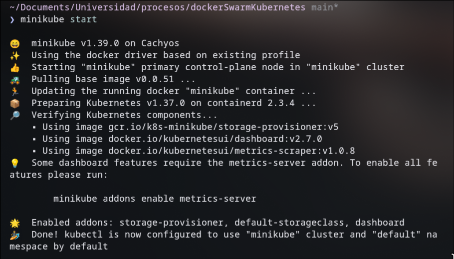

### 5.2 Primer Pod (sin controlador)

```bash
kubectl apply -f pod.yaml
kubectl get pods
kubectl delete pod grafana-pod
kubectl get pods
```

En el primer listado aparece `grafana-pod` en estado `Running`. Tras eliminarlo, el segundo listado ya **no lo muestra**: al no estar administrado por ningún controlador, nadie lo vuelve a crear. En cambio, los Pods `grafana-547d968fc8-*`, que pertenecen al ReplicaSet del Deployment, continúan en ejecución.

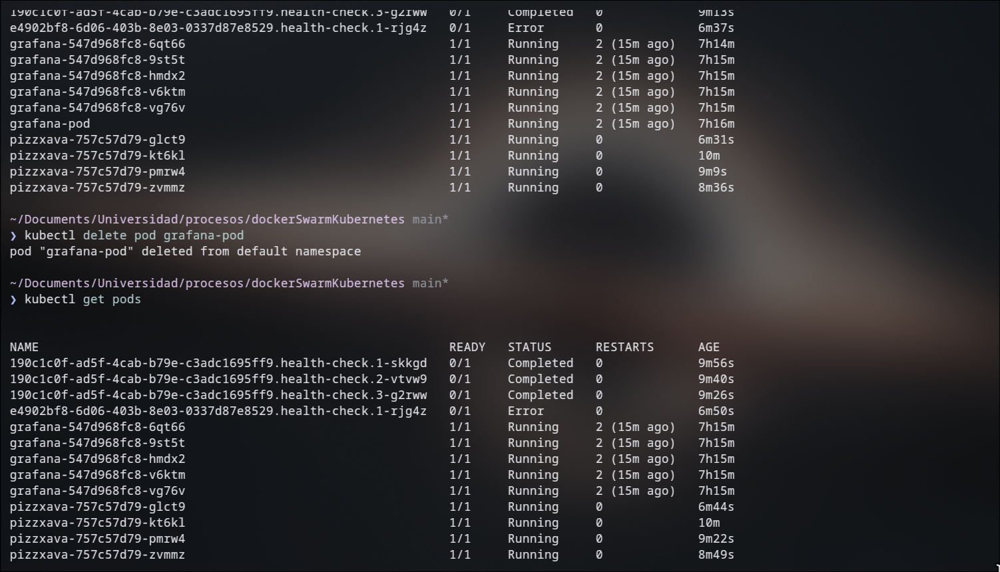

### 5.3 Deployment, ReplicaSet y Service

```bash
kubectl apply -f grafana.yaml
kubectl get deploy,rs,pods,svc -o wide
```

Al aplicar `grafana.yaml` se crean el Deployment y el Service. El Deployment, a su vez, crea **automáticamente** un ReplicaSet, sin que este aparezca en el YAML:

- `deployment.apps/grafana` con `3/3` réplicas listas, imagen `grafana/grafana:11.2.0` y selector `app=grafana`.
- `replicaset.apps/grafana-599c5d6dbc` con `DESIRED 3`, `CURRENT 3`, `READY 3`. Su selector incluye `pod-template-hash=599c5d6dbc`: es el *hash* de la plantilla del Pod y explica el nombre del ReplicaSet.
- Tres Pods `grafana-599c5d6dbc-*` en `Running 1/1`, cada uno con su propia IP interna (`10.244.0.x`). El prefijo del nombre indica a qué ReplicaSet pertenecen.
- `service/grafana-svc` de tipo `NodePort`, puerto `3000:30300/TCP`, que selecciona los Pods con `app=grafana`.

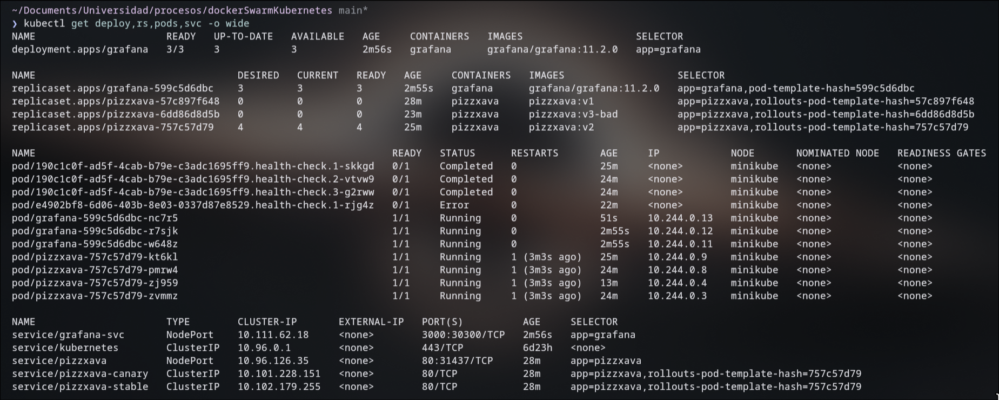

### 5.4 Autorreparación del ReplicaSet

```bash
kubectl get pods -l app=grafana
kubectl delete pod grafana-599c5d6dbc-8wffd
kubectl get pods -l app=grafana
```

Se listan los 3 Pods de Grafana y se elimina `grafana-599c5d6dbc-8wffd`, simulando una falla. En el siguiente listado vuelven a haber 3 Pods: el ReplicaSet detectó que había menos de los deseados y creó `grafana-599c5d6dbc-nc7r5` (AGE 7 s) a partir de su plantilla. El Pod nuevo aparece en `0/1` porque la *readiness probe* todavía no responde OK; segundos después pasa a `1/1` (se puede ver ya listo en la captura 3, con AGE 51 s).

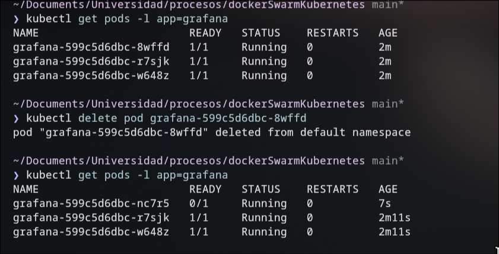

### 5.5 Escalado horizontal

```bash
kubectl scale deploy/grafana --replicas=5
kubectl get rs -l app=grafana
```

`kubectl scale` cambia el número de réplicas de 3 a 5 sin editar el YAML. El Deployment traslada ese valor a su ReplicaSet `grafana-599c5d6dbc`, que crea los 2 Pods que faltan hasta quedar con `DESIRED 5`, `CURRENT 5` y `READY 5`. Si alguno aparece aún sin estar listo (`READY` menor que `CURRENT`), es porque su *readiness probe* todavía no responde OK.

*[Captura 5: escalado a 5 réplicas]*

### 5.6 Rolling update y rollback

**Actualización a la versión 11.3.0:**

```bash
kubectl set image deploy/grafana grafana=grafana/grafana:11.3.0
kubectl annotate deploy/grafana kubernetes.io/change-cause="actualizar a 11.3.0"
kubectl rollout status deploy/grafana
```

`set image` cambia la imagen del contenedor; como la plantilla cambió, el Deployment crea un ReplicaSet nuevo. `annotate` registra el motivo del cambio para que aparezca en el historial. `rollout status` muestra el reemplazo progresivo: los Pods nuevos se van creando de a uno o dos (`2 out of 5`, `3 out of 5`, `4 out of 5 new replicas have been updated`) mientras se eliminan los antiguos (`1 old replicas are pending termination`), respetando `maxSurge: 1` y `maxUnavailable: 1`, hasta `successfully rolled out`. En ningún momento quedan todos los Pods fuera de servicio.

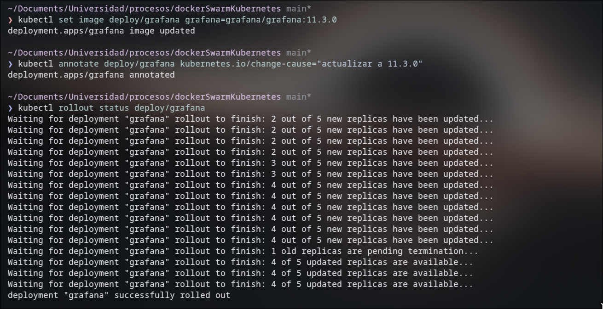

**ReplicaSets e historial de revisiones:**

```bash
kubectl get rs -l app=grafana
kubectl rollout history deploy/grafana
```

- `grafana-547d968fc8` es el ReplicaSet **nuevo** (11.3.0) con 5/5 Pods; `grafana-599c5d6dbc` es el **anterior** (11.2.0) y quedó en 0. El ReplicaSet viejo no se elimina: se conserva para poder volver atrás.
- `rollout history` muestra la revisión 1 (versión inicial) y la revisión 2 con el motivo `actualizar a 11.3.0`.

Aquí se ve la diferencia clave: un ReplicaSet solo mantiene N copias de **una** versión; el Deployment administra **varios** ReplicaSets para pasar de una versión a otra.

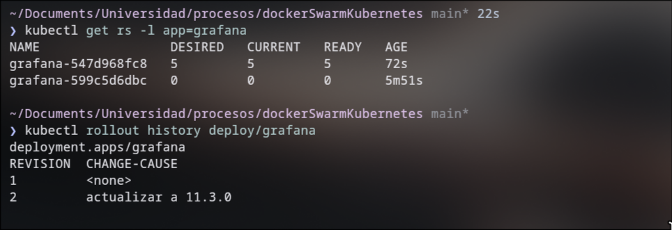

**Rollback a la versión anterior:**

```bash
kubectl rollout undo deploy/grafana
kubectl rollout status deploy/grafana
kubectl get rs -l app=grafana
```

`rollout undo` devuelve el Deployment a la revisión anterior (11.2.0). El proceso es otro rolling update, pero en sentido inverso: `grafana-599c5d6dbc` vuelve a 5/5 y `grafana-547d968fc8` baja a 0. Como el ReplicaSet antiguo ya existía, se reutiliza en lugar de crear uno nuevo.

Kubernetes muestra una advertencia: el Deployment fue creado con `kubectl apply` y el *rollback* no actualiza la anotación `last-applied-configuration`, por lo que un `apply` posterior podría comportarse de forma inesperada. En un entorno real lo recomendable es corregir la versión en el YAML y volver a aplicarlo.

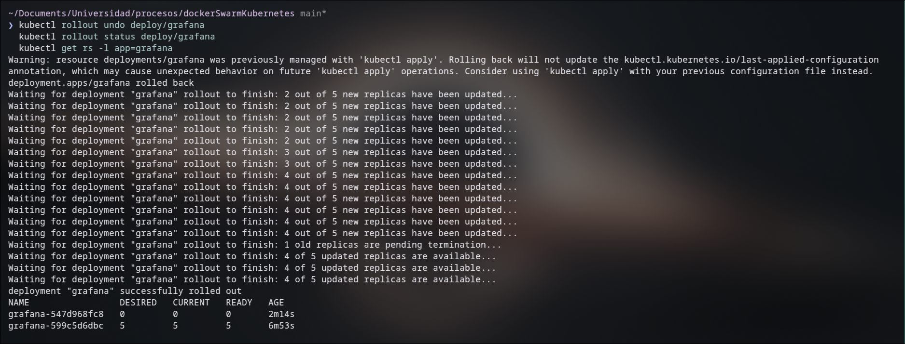

### 5.7 Exposición de la plataforma

```bash
kubectl get svc grafana-svc
minikube service grafana-svc --url
curl http://$(minikube ip):30300/api/health
```

El Service `grafana-svc` (NodePort `3000:30300/TCP`) es accesible en `http://192.168.49.2:30300`. La petición al endpoint de salud responde `"database": "ok"` y `"version": "11.2.0"`, lo que confirma dos cosas: que Grafana es accesible desde fuera del clúster y que el *rollback* del paso anterior se aplicó correctamente.

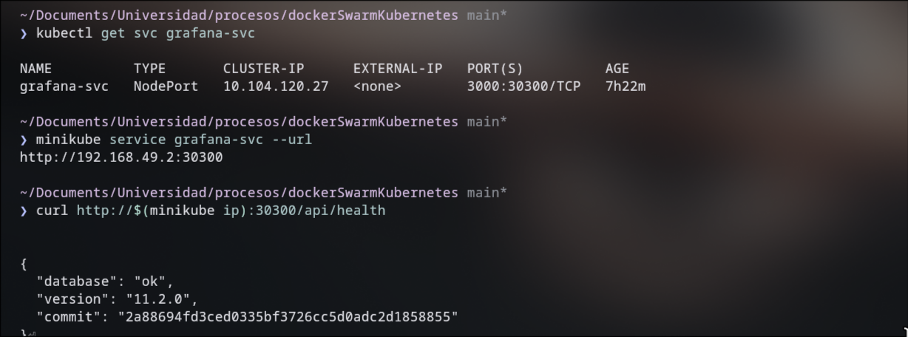

Al abrir `http://192.168.49.2:30300` en el navegador se muestra la pantalla de inicio de sesión de Grafana. En el pie de página se puede ver la versión desplegada (`Grafana v11.2.0`), la misma que reportó `/api/health`.

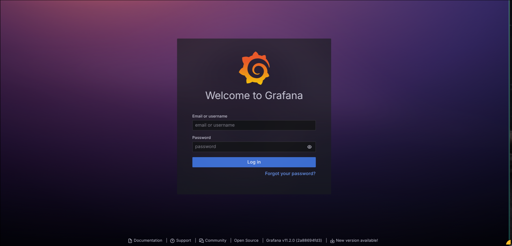

Se ingresa con el usuario `admin` y la contraseña `admin123`, definidos en las variables de entorno `GF_SECURITY_ADMIN_USER` y `GF_SECURITY_ADMIN_PASSWORD` del Deployment. Se accede a la página principal, con el menú de navegación (Dashboards, Explore, Alerting, Connections, Administration) y la guía inicial para agregar una fuente de datos y crear el primer *dashboard*.

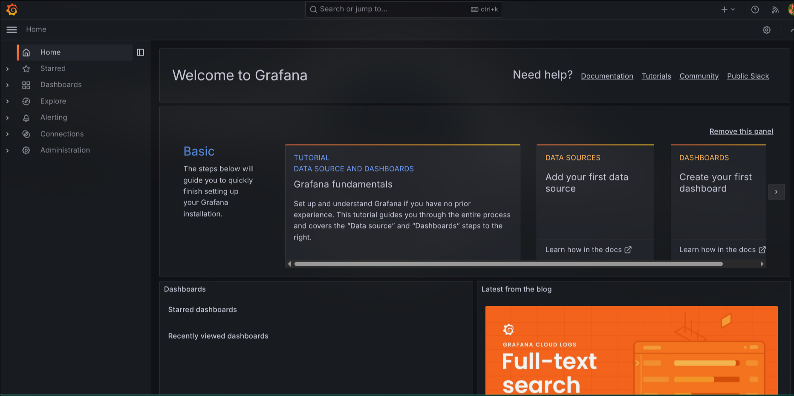

Por último, desde **Explore** se ejecutó una consulta de prueba con la fuente de datos integrada `-- Grafana --` y el tipo de consulta *Random Walk*, que genera una serie temporal de ejemplo. Grafana la representa como gráfico de líneas y como tabla, lo que demuestra que la plataforma desplegada en Kubernetes es plenamente funcional.

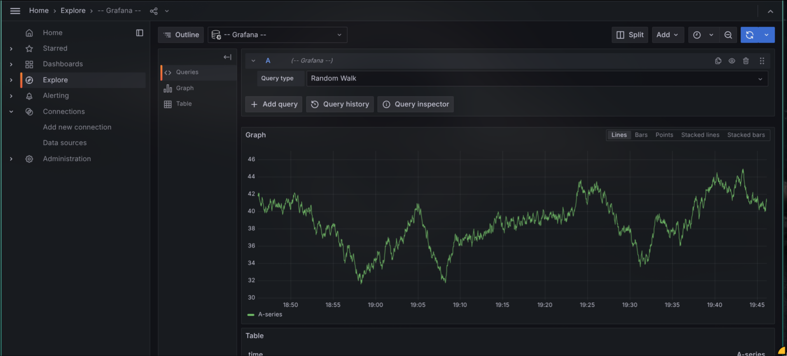

### 5.8 Limpieza

```bash
kubectl delete -f grafana.yaml -f pod.yaml
minikube stop
```

## 6. Investigación

### 6.1 ¿Qué es Grafana y para qué se usa?

Grafana es una plataforma de código abierto (licencia AGPLv3) desarrollada por Grafana Labs para **consultar, visualizar, alertar y explorar métricas, logs y trazas** independientemente de dónde estén almacenados. No guarda los datos por sí misma: se conecta a "fuentes de datos" (*data sources*) como Prometheus, InfluxDB, Loki, Elasticsearch, PostgreSQL o MySQL y los presenta en *dashboards* interactivos. Sus usos principales son:

- **Monitoreo de infraestructura**: uso de CPU, memoria, disco y red de servidores y clústeres Kubernetes, normalmente junto con Prometheus (stack conocido como *Prometheus + Grafana*).
- **Observabilidad de aplicaciones**: latencia, tasa de errores y peticiones por segundo; integra logs (Grafana Loki) y trazas distribuidas (Grafana Tempo) en una misma vista.
- **Alertas**: reglas que notifican por correo, Slack, Microsoft Teams, PagerDuty, etc. cuando una métrica supera un umbral.
- **Inteligencia de negocio**: paneles de KPIs (ventas, usuarios activos, conversiones) consultando directamente bases de datos SQL.
- **IoT e industria**: visualización en tiempo real de datos de sensores almacenados en bases de series temporales como InfluxDB.

### 6.2 ¿Qué es un ReplicaSet y para qué se usa?

Según la documentación oficial de Kubernetes, el propósito de un ReplicaSet es **mantener un conjunto estable de Pods réplica en ejecución en todo momento**, garantizando la disponibilidad de un número específico de Pods idénticos. Se define con tres elementos: un **selector** que identifica qué Pods le pertenecen, un **número de réplicas** y una **plantilla** para crear Pods nuevos. Funciona como un bucle de control: compara constantemente el estado actual con el deseado y crea o elimina Pods para igualarlos.

Usos:

- **Alta disponibilidad**: si un Pod falla o el nodo donde corre se cae, se crea uno nuevo automáticamente (visto en la sección 5.4).
- **Escalado horizontal**: aumentar o disminuir el número de copias según la carga (sección 5.5).

La documentación recomienda **no crear ReplicaSets directamente**, sino usar Deployments, que los administran.

### 6.3 ¿Qué es un Deployment y para qué se usa?

Un Deployment proporciona **actualizaciones declarativas** para Pods y ReplicaSets: el usuario describe el estado deseado y el controlador del Deployment cambia el estado real hacia él a un ritmo controlado. Usos principales:

- **Desplegar una aplicación**: crea el ReplicaSet y este, a su vez, los Pods.
- **Actualizar sin interrupción del servicio** (*rolling update*): crea un ReplicaSet nuevo y traslada los Pods gradualmente, respetando `maxSurge` y `maxUnavailable` (sección 5.6).
- **Volver a una versión anterior** (*rollback*) con `kubectl rollout undo`, gracias a que conserva los ReplicaSets anteriores (controlado por `revisionHistoryLimit`, 10 por defecto).
- **Escalar** la aplicación y **pausar/reanudar** despliegues para aplicar varios cambios a la vez.
- Integrarse con el **HorizontalPodAutoscaler (HPA)** para escalar automáticamente según CPU, memoria u otras métricas.

### 6.4 Diferencias entre Pod, ReplicaSet y Deployment

| Característica | Pod | ReplicaSet | Deployment |
|---|---|---|---|
| Nivel | Unidad mínima | Controlador de Pods | Controlador de ReplicaSets |
| Se recupera si se elimina | No | Sí (recrea Pods) | Sí (a través del ReplicaSet) |
| Escalado | No | Sí | Sí |
| Rolling update | No | No | Sí |
| Historial y rollback | No | No | Sí |
| Uso recomendado | Pruebas puntuales | Indirecto (vía Deployment) | Aplicaciones *stateless* en producción |

### 6.5 Consideración sobre Grafana con varias réplicas

Por defecto Grafana guarda usuarios y dashboards en una base **SQLite** dentro del propio contenedor. Con varias réplicas, cada Pod tiene su propia base y los datos no se comparten (y se pierden si el Pod se recrea). Para un despliegue de alta disponibilidad real, la documentación de Grafana indica configurar una **base de datos externa compartida** (MySQL o PostgreSQL) mediante las variables `GF_DATABASE_*`, y gestionar los dashboards como código (*provisioning*).

## 7. Conclusiones

- Un **Pod** creado directamente no tiene ningún mecanismo de recuperación: al eliminarlo desaparece definitivamente.
- El **ReplicaSet** mantiene el número deseado de Pods; al eliminar uno, crea otro en segundos, y al cambiar `replicas` escala la aplicación sin editar los manifiestos.
- El **Deployment** es la forma recomendada de trabajar: crea los ReplicaSets automáticamente y permite actualizar la versión de Grafana de forma progresiva y revertirla con un solo comando, conservando los ReplicaSets anteriores.
- La **readiness probe** evita que el Service envíe tráfico a Pods que aún están iniciando, lo que se observó en los estados `0/1` durante el escalado y la actualización.
- El **Service NodePort** permitió acceder a Grafana desde fuera del clúster, y la consulta a `/api/health` confirmó tanto la exposición como la versión desplegada tras el *rollback*.

## 8. Referencias

- Kubernetes. *Pods*. https://kubernetes.io/docs/concepts/workloads/pods/
- Kubernetes. *ReplicaSet*. https://kubernetes.io/docs/concepts/workloads/controllers/replicaset/
- Kubernetes. *Deployments*. https://kubernetes.io/docs/concepts/workloads/controllers/deployment/
- Kubernetes. *Service*. https://kubernetes.io/docs/concepts/services-networking/service/
- Kubernetes. *Configure Liveness, Readiness and Startup Probes*. https://kubernetes.io/docs/tasks/configure-pod-container/configure-liveness-readiness-startup-probes/
- Grafana Labs. *Grafana documentation*. https://grafana.com/docs/grafana/latest/
- Grafana Labs. *Set up Grafana for high availability*. https://grafana.com/docs/grafana/latest/setup-grafana/set-up-for-high-availability/
- Minikube. *Documentation*. https://minikube.sigs.k8s.io/docs/
